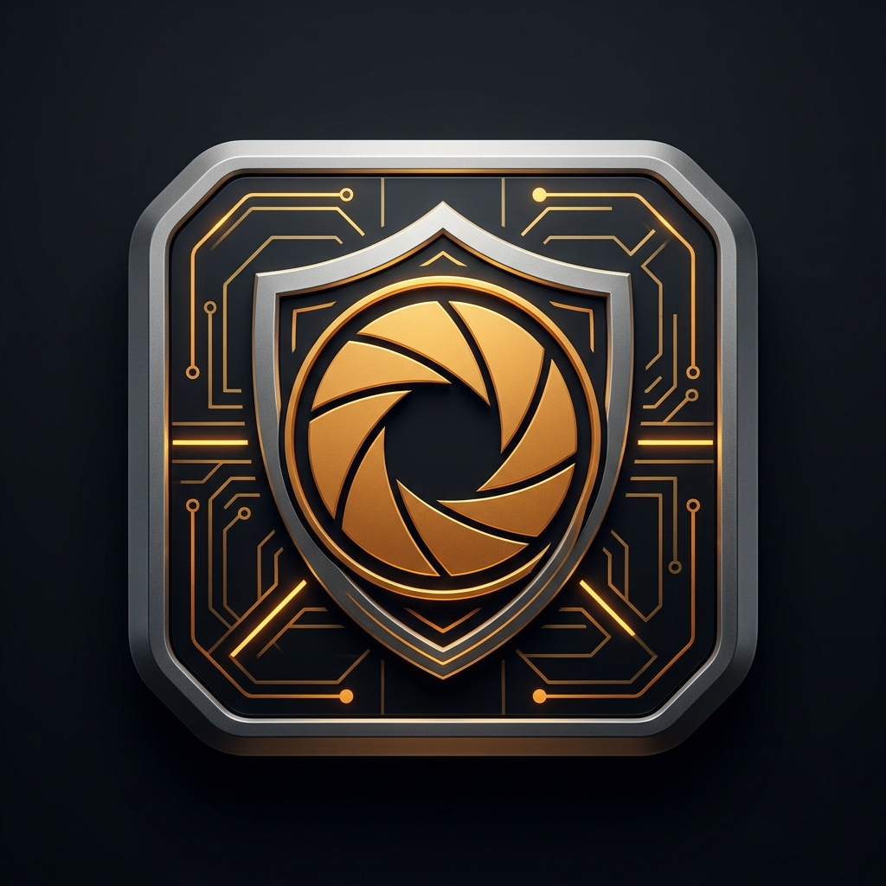
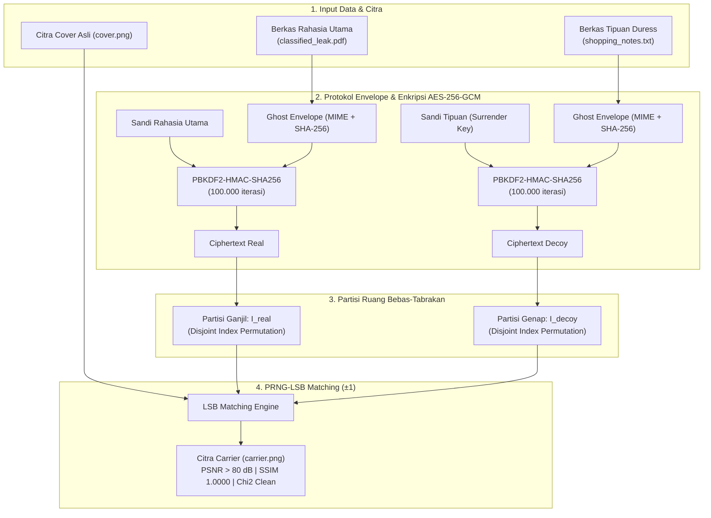

# 🛡️ GhostShare: Deniable Covert Data Vault & Anti-Censorship System

<p align="center">
  
</p>

GhostShare adalah sistem brankas data tersembunyi (*covert data vault*) tingkat produksi (*production-grade*) berbasis steganografi dan kriptografi modern. Dirancang khusus untuk jurnalis investigasi, pelapor pelanggaran (*whistleblowers*), peneliti keamanan, dan aktivis hak asasi manusia yang beroperasi di bawah pengawasan siber ketat (*adversarial surveillance / deep packet inspection*).

---

## 🌟 Fitur Utama

1. **Plausible Deniability (Multi-Passphrase / Decoy Mode)**:
   - **Real Passphrase**: Membuka berkas rahasia utama (dokumen classified, database `.kdbx`, kunci PGP).
   - **Decoy Passphrase**: Membuka berkas tipuan yang tampak wajar (catatan belanja, memo publik, foto keluarga) jika pengguna dipaksa menyerahkan kata sandi di bawah tekanan (*rubber-hose cryptanalysis*).
   - Partisi ruang koordinat dijamin bebas-tabrakan ($I_{\text{real}} \cap I_{\text{decoy}} = \emptyset$). Lawan tidak dapat membuktikan secara matematis keberadaan berkas rahasia kedua.
2. **Zero-Auxiliary Footprint (100% Self-Contained Carrier)**:
   - Tidak memerlukan file kunci `.key` atau berkas metadata eksternal terpisah. Citra pembawa (`carrier.png`) adalah satu-satunya file yang dibutuhkan untuk mengekstrak data.
3. **Arbitrary Binary Payload Support**:
   - Mendukung semua jenis file biner (PDF, ZIP, DOCX, TXT, KDBX, audio, gambar) dengan preservasi otomatis nama file asli, MIME-type, dan checksum SHA-256 via protokol *Ghost Envelope*.
4. **Anti-Steganalysis & Forensic Audit**:
   - Algoritma **PRNG-LSB Matching ($\pm 1$)** menjaga simetri histogram nilai pasangan (*Pairs of Values*) sehingga lolos dari uji **Chi-Square ($\chi^2$)** Westfeld.
   - Fidelitas visual tinggi: **PSNR > 80 dB**, **SSIM 1.0000** (secara visual dan statistik identik dengan citra asli).
5. **Antarmuka Web Modern & Siap Dideploy (Docker-Ready)**:
   - Antarmuka web bertema *Precision Cryptographic Field Instrument* (Obsidian & Magnesium Amber) dengan 3 tab interaktif: Pack Vault, Unpack Vault, dan Forensic Studio.
   - Didukung arsitektur ASGI Starlette + Uvicorn berkecepatan tinggi dengan REST API dan visualisasi komparator optik interaktif.
   - Disertai `Dockerfile` dan `docker-compose.yml` tingkat produksi dengan keamanan *non-root user* dan *healthcheck endpoint*.

---

## 📐 Arsitektur Alur Kerja & Plausible Deniability

Sistem mempartisi ruang piksel pembawa secara independen dan mendistribusikan bit muatan terenkripsi menggunakan permutasi pseudo-acak yang diturunkan dari hash kata sandi:



---

## 📂 Struktur Direktori Proyek

```
steganwatermark/
├── core/                                # CORE CRYPTO & STEGANOGRAPHY ENGINE
│   ├── envelope.py                      # Binary envelope serialization & MIME detection
│   ├── deniable.py                      # Collision-free PRNG coordinate partitioning
│   ├── vault.py                         # High-level GhostShare Vault orchestrator
│   ├── crypto.py                        # AES-256-GCM + PBKDF2-HMAC-SHA256
│   ├── steganography.py                 # PRNG-LSB Matching (±1 embedding)
│   ├── anti_steganalysis.py             # Chi-Square PoV & Forensic audit suite
│   ├── watermark.py                     # DWT-SVD Frequency Engine
│   ├── pipeline.py                      # Dual-Domain Pipeline Orchestrator
│   └── metrics.py                       # PSNR, SSIM, MSE, NC, BER
│
├── static/                              # ASET VISUAL & IDENTITAS BRAND
│   ├── icon.png                         # Master emblem resolusi tinggi (1024x1024)
│   ├── favicon.png                      # Web favicon (64x64)
│   └── favicon.ico                      # Multi-resolution icon browser
│
├── templates/
│   └── index.html                       # Antarmuka web single-page application (SPA)
│
├── tests/
│   ├── test_ghostshare.py               # Unit tests untuk GhostShare (7 tests)
│   ├── test_core.py                     # Unit tests untuk core engine (11 tests)
│   └── test_web_api.py                  # Integration tests untuk REST & ASGI Web API (4 tests)
│
├── ghostshare_cli.py                    # Production CLI interface
├── app.py                               # Production Starlette ASGI Web Vault application
├── Dockerfile                           # Production container definition
├── docker-compose.yml                   # Container orchestration
├── requirements.txt                     # Dependensi Python
└── output/                              # Folder hasil carrier & berkas terekstraksi
```

---

## 🛠️ Prasyarat & Instalasi Cepat

### Prasyarat Sistem
* Python 3.10 atau lebih baru (direkomendasikan Python 3.11 / 3.12).
* OS: Linux, macOS, atau Windows.

### Langkah Instalasi Lingkungan Virtual
```bash
# 1. Klon repositori
git clone https://github.com/username/steganwatermark.git
cd steganwatermark

# 2. Buat dan aktifkan virtual environment Python
python3 -m venv .venv
source .venv/bin/activate       # Untuk Linux/macOS
# .venv\Scripts\activate        # Untuk Windows PowerShell

# 3. Pasang dependensi
pip install --upgrade pip
pip install -r requirements.txt
```

---

## 🌐 Panduan Antarmuka Web Vault (`app.py`)

GhostShare menyediakan antarmuka web modern bergaya *Precision Cryptographic Field Instrument* yang berjalan tanpa dependensi eksternal yang rumit.

### 1. Menjalankan Server Web Lokal
```bash
# Menjalankan langsung melalui ASGI runner:
python app.py
```
Atau menggunakan `uvicorn`:
```bash
uvicorn app:app --host 0.0.0.0 --port 8501
```
Akses antarmuka melalui browser: **`http://localhost:8501`**.

### 2. Alur Penggunaan Tiap Tab Antarmuka:

#### **Tab 1: Pack Carrier (Pengemasan Berkas)**
1. **Pilih Citra Pembawa (Cover)**: Pilih salah satu preset terkalibrasi (`Cover Sample 1024px`, `Lena`, `Peppers`, dll.) atau seret & lepas (*drag & drop*) file citra PNG/JPEG Anda sendiri.
2. **Pantau Gauge Kapasitas**: Indikator kapasitas visual akan menghitung secara *real-time* berapa kilobyte ruang yang tersedia pada citra pembawa.
3. **Pilih Berkas Rahasia Utama**: Masukkan berkas yang ingin disembunyikan (PDF, DOCX, ZIP, KDBX, dll.) dan ketik **Secret Passphrase**.
4. **Opsi Plausible Deniability (Duress Mode)**:
   - Geser tombol **Duress partition (Decoy mode)** jika beroperasi di lingkungan berisiko tinggi.
   - Unggah berkas tipuan yang tidak mencurigakan (misal: `shopping_list.txt` atau resep masakan).
   - Tentukan **Decoy Passphrase** (wajib berbeda dari sandi rahasia utama).
5. **Kunci & Unduh**: Klik tombol **Seal and pack carrier**. Setelah proses selesai, unduh berkas `ghost_carrier.png` atau klik **Inspect in forensic studio** untuk langsung mengauditnya.

#### **Tab 2: Extract Payload (Pembongkaran Brankas)**
1. **Unggah Citra Pembawa**: Seret berkas `carrier.png` yang telah berisi muatan tersembunyi.
2. **Masukkan Kata Sandi**:
   - Jika memasukkan **Secret Passphrase**, berkas rahasia utama akan terbuka.
   - Jika memasukkan **Decoy Passphrase**, berkas tipuan yang akan terbuka.
   *Sistem mendeteksi slot partisi secara otomatis tanpa membocorkan keberadaan slot lainnya.*
3. **Pratinjau & Unduh**: Jika muatan berupa berkas teks/markdown/JSON, pratinjau konten akan ditampilkan di layar. Klik **Download extracted file** untuk menyimpan berkas asli.

#### **Tab 3: Forensic Studio (Audit Steganalisis)**
1. Unggah berkas `carrier.png` pada kolom audit.
2. (Opsional) Unggah citra cover asli untuk membandingkan delta fidelitas piksel.
3. Klik **Run statistical audit**.
4. **Hasil Diagnostik Forensik**:
   - **Stealth Safety Score**: Tingkat keamanan carrier terhadap deteksi statistik.
   - **Chi-Square p-value**: Mengukur ketidakseimbangan frekuensi PoV (*Pairs of Values*). Nilai mendekati 0.0000 menandakan tidak adanya anomali steganografi LSB tradisional.
   - **PSNR & Max Delta**: Menampilkan rasio distorsi visual (biasanya > 80 dB) dan batas mutasi piksel ($\pm 1$).
   - **Optical Swipe Comparator**: Geser slider komparator optik untuk membandingkan citra sebelum dan sesudah secara pixel-perfect tanpa distorsi.
   - **Amplified Residual Heatmap (25×)**: Visualisasi dispersi acak residu modifikasi piksel.

---

## 🚀 Panduan Penggunaan CLI (`ghostshare_cli.py`)

Bagi kebutuhan otomasi terminal atau server tanpa tampilan grafis (headless), gunakan antarmuka baris perintah:

### 1. Memeriksa Kapasitas Citra Pembawa
```bash
python ghostshare_cli.py capacity --cover input/cover.png
```

### 2. Menyembunyikan Berkas Rahasia (Single Payload Mode)
```bash
python ghostshare_cli.py pack \
  --cover input/cover.png \
  --secret secret_document.pdf \
  --secret-pass "MySecretPassphrase2026!" \
  --output output/carrier.png
```

### 3. Menyembunyikan Berkas dengan Plausible Deniability (Dual Mode)
```bash
python ghostshare_cli.py pack \
  --cover input/cover.png \
  --secret secret_document.pdf \
  --secret-pass "RealSecretKey2026!" \
  --decoy innocent_notes.txt \
  --decoy-pass "InnocentDecoyPass123!" \
  --output output/covert_carrier.png
```

### 4. Membuka & Mengekstrak Berkas
Gunakan sandi apa pun yang Anda miliki (sandi tipuan akan mengekstrak berkas tipuan; sandi asli akan mengekstrak berkas rahasia):
```bash
# Ekstrak berkas tipuan:
python ghostshare_cli.py unpack \
  --carrier output/covert_carrier.png \
  --passphrase "InnocentDecoyPass123!" \
  --out-dir output/recovered/

# Ekstrak berkas rahasia utama:
python ghostshare_cli.py unpack \
  --carrier output/covert_carrier.png \
  --passphrase "RealSecretKey2026!" \
  --out-dir output/recovered/
```

### 5. Audit Forensik & Steganalisis
```bash
python ghostshare_cli.py audit \
  --carrier output/covert_carrier.png \
  --cover input/cover.png
```

---

## 📡 Dokumentasi Referensi REST API

Aplikasi Web Vault menyediakan REST API berbasis format `multipart/form-data` untuk integrasi otomatisasi backend:

### 1. `POST /api/capacity`
Menghitung batas kapasitas byte muatan untuk citra tertentu.

* **Parameter Form**: `preset` (string) ATAU `cover_file` (file binary).
* **Contoh Request**:
  ```bash
  curl -X POST http://localhost:8501/api/capacity \
    -F "preset=Cover Sample (1024x1024)"
  ```
* **Contoh Response JSON**:
  ```json
  {
    "total_pixels": 3145728,
    "single_payload_max_bytes": 393108,
    "dual_payload_max_bytes_each": 196500,
    "width": 1024,
    "height": 1024
  }
  ```

### 2. `POST /api/pack`
Mengenkripsi dan menyematkan berkas ke dalam citra pembawa.

* **Parameter Form**:
  - `cover_file` (file) atau `preset` (string, misal: `"Lena (512x512)"`)
  - `secret_file` (file, wajib)
  - `secret_pass` (string, wajib)
  - `decoy_file` (file, opsional untuk dual mode)
  - `decoy_pass` (string, opsional untuk dual mode)
* **Contoh Request**:
  ```bash
  curl -X POST http://localhost:8501/api/pack \
    -F "preset=Cover Sample (1024x1024)" \
    -F "secret_file=@classified_leak.pdf" \
    -F "secret_pass=StrongMasterKey2026!" \
    -F "decoy_file=@shopping_list.txt" \
    -F "decoy_pass=InnocentKey123!"
  ```
* **Contoh Response JSON**:
  ```json
  {
    "success": true,
    "carrier_url": "data:image/png;base64,iVBORw0KGgoAAAANSU...",
    "audit": {
      "psnr_db": 81.5,
      "ssim": 1.0,
      "stealth_score": 100.0,
      "mode": "dual_deniable",
      "verdict": "Clean / Stealth Secure"
    }
  }
  ```

### 3. `POST /api/unpack`
Mengekstrak dan mendekripsi berkas muatan dari citra pembawa.

* **Parameter Form**:
  - `carrier_file` (file, wajib)
  - `passphrase` (string, wajib)
* **Contoh Request**:
  ```bash
  curl -X POST http://localhost:8501/api/unpack \
    -F "carrier_file=@ghost_carrier.png" \
    -F "passphrase=StrongMasterKey2026!"
  ```
* **Contoh Response JSON**:
  ```json
  {
    "success": true,
    "filename": "classified_leak.pdf",
    "mime_type": "application/pdf",
    "size_bytes": 14520,
    "partition_mode": "odd",
    "download_url": "data:application/pdf;base64,JVBERi0xLjQK...",
    "is_text": false,
    "text_content": ""
  }
  ```

### 4. `POST /api/audit`
Menjalankan audit diagnostik forensik & steganalisis pada citra pembawa.

* **Parameter Form**:
  - `carrier_file` (file, wajib)
  - `cover_file` (file, opsional untuk perbandingan diferensial)
* **Contoh Request**:
  ```bash
  curl -X POST http://localhost:8501/api/audit \
    -F "carrier_file=@ghost_carrier.png" \
    -F "cover_file=@original_cover.png"
  ```
* **Contoh Response JSON**:
  ```json
  {
    "success": true,
    "stealth_score": 100.0,
    "chi2_p_value": 0.0,
    "psnr_db": 81.5,
    "max_pixel_delta": 1,
    "verdict": "Clean / Stealth Secure",
    "cover_url": "data:image/png;base64,...",
    "carrier_url": "data:image/png;base64,...",
    "residual_url": "data:image/png;base64,..."
  }
  ```

---

## 🔒 Panduan Operasional Keamanan (OPSEC & Praktik Terbaik)

Sebagai instrumen anti-pengawasan lapangan, efektivitas steganografi sangat bergantung pada disiplin operasional pengguna:

1. **Wajib Hindari Kompresi Lossy (Kompresi Gambar Media Sosial / Pesan Singkat)**:
   > [!WARNING]
   > Kompresi gambar standar pada WhatsApp, Telegram (mode foto reguler), Instagram, Facebook, atau Twitter akan mengonversi citra menjadi format lossy JPEG yang **mengacak dan menghancurkan bit LSB**. Akibatnya, muatan data rahasia tidak akan dapat diekstrak kembali.
   > **Solusi**: Selalu kirimkan berkas `carrier.png` sebagai **Document / File (Uncompressed File)**, melalui cloud drive terenkripsi, atau menggunakan USB drive fisik.

2. **Karakteristik Citra Pembawa yang Ideal**:
   - Gunakan citra foto dunia nyata (pemandangan luar ruangan, dedaunan, permukaan bertekstur, foto jalanan) yang diambil dari kamera asli.
   - Hindari citra vektor datar (*flat illustrations*), gambar kartun dengan blok warna solid, atau tangkapan layar antarmuka bersih karena perubahan $\pm 1$ pada area solid lebih mudah dicurigai pada audit manual visual.

3. **Penghapusan Aman Berkas Sumber (Secure Shredding)**:
   - Setelah berkas rahasia berhasil dikemas ke dalam citra carrier, pastikan berkas asli di perangkat Anda dihancurkan secara permanen, bukan sekadar dipindahkan ke tempat sampah (*Trash/Recycle Bin*):
     ```bash
     # Linux / macOS (menggunakan utilitas srm atau shred):
     shred -u -z -n 3 secret_document.pdf
     ```

4. **Entropi Kata Sandi**:
   - Gunakan kata sandi dengan panjang minimal 16 karakter acak atau passphrase multi-kata berentropi tinggi. Sistem menggunakan PBKDF2-HMAC-SHA256 sebanyak 100.000 iterasi untuk memitigasi serangan kamus (*dictionary attack*).

---

## 🐳 Deployment via Docker / Docker Compose

Aplikasi telah dikonfigurasi dengan container minimalis non-root dan healthcheck endpoint bawaan.

### Menggunakan Docker Compose (Direkomendasikan):
```bash
docker compose up -d
```
Periksa status kontainer:
```bash
docker compose ps
```
Melihat log sistem:
```bash
docker compose logs -f
```

### Menggunakan Docker Langsung:
```bash
# 1. Build image
docker build -t ghostshare-vault:latest .

# 2. Jalankan container
docker run -d -p 8501:8501 --name ghostshare ghostshare-vault:latest
```

---

## 🧪 Menjalankan Pengujian Otomatis (Unit Tests)

Proyek ini dilengkapi dengan 22 pengujian otomatis menyeluruh mencakup kriptografi, mitigasi serangan citra (JPEG compression, noise, blur), isolasi partisi ganda, hingga integrasi Web API:

```bash
# Jalankan seluruh test suite:
python -m unittest discover -s tests -p "test_*.py" -v
```

Hasil verifikasi:
```text
Ran 22 tests in ~2.0s
OK
```
